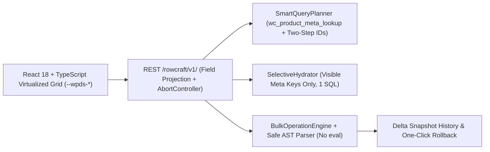

# RowCraft

**High-performance admin columns, zero-shift inline spreadsheet editor, safe AST bulk formula engine, and one-click rollback for WordPress & WooCommerce.**

`100% Free & Open Source (GPL-2.0-or-later)` · `Zero Frontend Footprint (0 KB)` · `6–8 SQL Queries/Page` · `~25 KB Gzipped Initial Bundle`

---

## Why RowCraft Exists

Essential WordPress content and catalog operations—inline editing custom fields, bulk-adjusting WooCommerce prices, inspecting ACF/SEO metadata in columns, and safely rolling back bulk mistakes—are historically fragmented across expensive annual paywalls (**Admin Columns Pro**, **WP Sheet Editor**, **SwiftGrid Pro**).

RowCraft delivers all of them in a single, razor-sharp, zero-upsell open-source plugin engineered for **100,000+ record catalogs** and aligned natively with WordPress 6.9/7.0's `--wpds-*` design tokens.

---

## Key Capabilities

- **Universal Entity Engine:** Posts, Pages, any Custom Post Type (CPT), Media Library (`alt` text & dimensions audit), Users, WooCommerce Products (with **inline expandable Variation sub-rows**), and **HPOS Orders**.
- **Zero-Shift Spreadsheet Editing:** Fixed-geometry cells (`Compact 30px` / `Default 36px` / `Comfortable 48px`) with `0px` layout shift on focus/edit, `tabular-nums` alignment, pinned primary column, resizable column headers, `Tab`/`Enter`/`Arrow` navigation, **Staged Save** (with `Cmd/Ctrl+Z` undo) & **Instant Save** modes.
- **Excel & Google Sheets Interop:** Vertical range selection (`Shift+Click` / `Shift+Arrows`), multi-cell TSV paste (`Ctrl/Cmd+V`), copy (`Ctrl/Cmd+C`), Fill Down (`Cmd/Ctrl+D`), and a Linear-style **`Cmd/Ctrl+K` Command Palette**.
- **Zero-Paywall Integrations:** Core Fields, Native Meta auto-discovery, **ACF & Secure Custom Fields (SCF)**, **Meta Box**, **WooCommerce CRUD & HPOS**, **Yoast SEO**, and **Rank Math** (with live `60`/`160` character meters).
- **Safe AST Formula Bulk Engine (Zero `eval()`):** Recursive-descent tokenizer, parser, and evaluator supporting arithmetic, conditionals (`if`), rounding (`.99` / `.95`), string functions, dynamic templates (`{title} | {site_name}`), **Dry-Run Before/After Diff Preview**, and adaptive chunking.
- **Safety Net & Scheduled Campaigns:** Compact delta-snapshot audit tables (`{prefix}_rowcraft_batches` & `{prefix}_rowcraft_changes`) powering **One-Click Batch Rollback** and **Scheduled Auto-Reverting Campaigns** (e.g., weekend flash sale that automatically restores exact pre-sale prices).
- **Built-in Audit Lenses:** Zero-setup views for *Pricing & SKU Audit*, *Inventory Risk*, *Missing Images*, *SEO Audit*, *Content Hygiene*, and *Missing Alt Text*.
- **Developer & Agency Ready:** Role-based Saved Views with **`rowcraft-json/`** Git auto-sync (just like `acf-json/`), **WP-CLI** commands, and **WordPress 6.9+ Abilities API** registration.

---

## Performance & Systems Architecture

| Metric | Measured Result | Engineering Mechanism |
| :--- | :--- | :--- |
| **Public Frontend Footprint** | **`0 B` JS / `0 B` CSS / `0` SQL** | Early-exit context guard in `rowcraft.php` skips bootstrap on public requests |
| **Initial Workspace Bundle** | **`25.3 KB` gzip** (budget `<= 45 KB`) | WP core externalization + `React.lazy()` code-splitting for all modals/drawers |
| **Native List Switcher** | **`0.66 KB` gzip** | Zero-dependency segmented pill injected only on supported list screens |
| **50 Products + ACF + Cats** | **`8 SQL` / `~3 ms`** (constant O(1) queries) | `SmartQueryPlanner` (`wc_product_meta_lookup`) + `SelectiveHydrator` (skips `_elementor_data` blobs) |
| **50 Posts + SEO + Terms** | **`6 SQL` / `~1.3 ms`** | Two-step ID selection (`no_found_rows`) + single-query selective term hydration |
| **50,000-Row CSV Export** | **Constant `~15 MB` PHP RAM** | Keyset cursor (`ID > $last_id`) streaming directly to `php://output` with CSV formula-injection neutralization |



---

## Local Development (Docker)

```bash
# 1. Install JS dependencies & build production assets
npm install
npm run build
npm run check:budget

# 2. Boot WordPress (PHP 8.2) + MariaDB + WP-CLI on http://localhost:8888
docker compose up -d

# 3. Install WordPress, WooCommerce, Secure Custom Fields, RowCraft & seed demo data
docker compose exec -T wpcli wp core install --url=http://localhost:8888 --title="RowCraft Dev" --admin_user=admin --admin_password=password --admin_email=admin@rowcraft.local --skip-email
docker compose exec -T wpcli wp plugin install woocommerce secure-custom-fields plugin-check --activate
docker compose exec -T wpcli wp plugin activate rowcraft
docker compose exec -T wpcli wp eval-file /var/www/html/wp-content/plugins/rowcraft/scripts/seed-demo-data.php --user=admin
```

Visit `http://localhost:8888/wp-admin/admin.php?page=rowcraft` (`admin` / `password`).

---

## Testing & Verification

```bash
# TypeScript strict check + Bundle budget gate (< 45 KB gzip)
npm run typecheck && npm run build && npm run check:budget

# PHPUnit Unit Tests + PHPCS (WPCS) + PHPStan
docker run --rm -v "$(pwd):/app" -w /app composer:2 test:unit
docker run --rm -v "$(pwd):/app" -w /app composer:2 lint:php

# Live WordPress + WooCommerce + SCF integration & SQL SLA verification
docker compose exec -T wpcli wp eval-file /var/www/html/wp-content/plugins/rowcraft/scripts/verify-integration.php --user=admin

# Build clean WordPress.org release ZIP
node scripts/build-release-zip.mjs
```

---

## WP-CLI Commands

```bash
wp rowcraft status --user=admin
wp rowcraft benchmark product --per-page=100 --user=admin
wp rowcraft bulk product --field=sale_price --action=formula --value="if(regular_price > 0, round(regular_price * 0.85, 0) - 0.01, '')" --dry-run --user=admin
wp rowcraft rollback <batch-uuid> --user=admin
wp rowcraft sync-json --user=admin
```

---

## License

GPL-2.0-or-later — see [GNU GPL v2](https://www.gnu.org/licenses/gpl-2.0.html).
