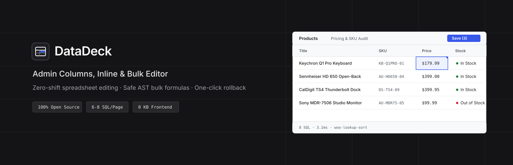
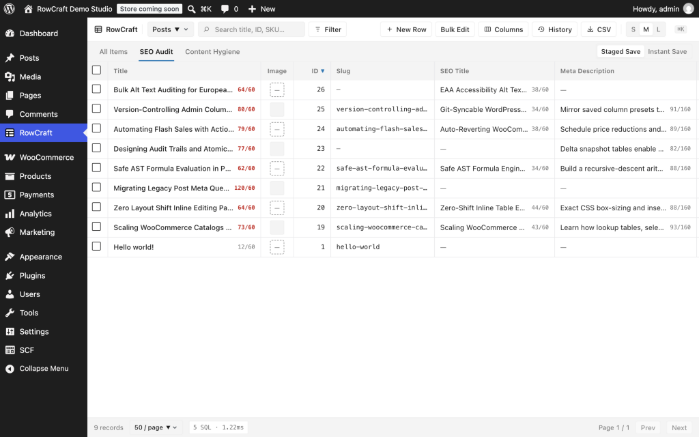
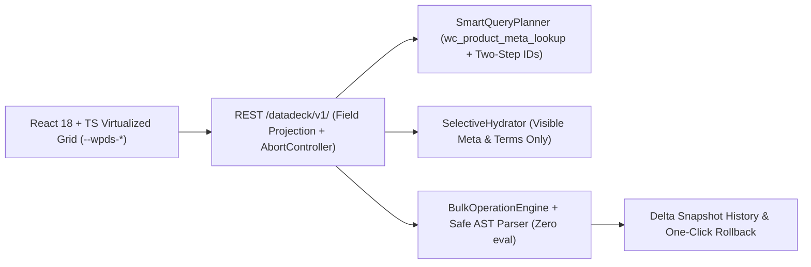

<p align="center">
  
</p>

<h1 align="center">DataDeck</h1>

<p align="center">
  <strong>High-performance admin columns, zero-shift inline spreadsheet editor, safe AST bulk formula engine, and one-click rollback for WordPress &amp; WooCommerce.</strong>
</p>

<p align="center">
  <a href="https://github.com/duhanguler/datadeck/actions/workflows/ci.yml"></a>
  <a href="https://github.com/duhanguler/datadeck/actions/workflows/plugin-check.yml"></a>
  <a href="https://github.com/duhanguler/datadeck/releases/latest"></a>
  
  
  
  
  <a href="LICENSE"></a>
</p>

<p align="center">
  <a href="https://playground.wordpress.net/?blueprint-url=https://raw.githubusercontent.com/duhanguler/datadeck/main/.wordpress-org/blueprints/blueprint.json"><strong>Try Live in Browser (WordPress Playground)</strong></a>
  &nbsp;&middot;&nbsp;
  <a href="https://github.com/duhanguler/datadeck/releases/latest/download/datadeck.zip"><strong>Download datadeck.zip (138 KB)</strong></a>
  &nbsp;&middot;&nbsp;
  <a href="#why-datadeck-vs-paid-alternatives"><strong>Comparison</strong></a>
  &nbsp;&middot;&nbsp;
  <a href="#performance--architecture"><strong>Benchmarks</strong></a>
  &nbsp;&middot;&nbsp;
  <a href="#local-development-docker"><strong>Docker Setup</strong></a>
</p>

---

## Interface Preview

> **Design Philosophy:** Built natively on WordPress 7.0+ `--wpds-*` design tokens with `0px` layout-shift inline cells, `tabular-nums` alignment, pinned primary columns, and `⌘K` keyboard control. No decorative gradients, no fake KPI bloat, no dashboard nags, no upsell walls.

<p align="center">
  
</p>

<table>
  <tr>
    <td width="50%">
      
      <p align="center"><sub><strong>Safe AST Formula Engine &amp; Dry-Run Diff Preview</strong> — Preview exact <code>Before → After</code> values before touching the database.</sub></p>
    </td>
    <td width="50%">
      
      <p align="center"><sub><strong>Built-in SEO Audit Lens</strong> — Instant character count meters (<code>60</code> / <code>160</code>) for Yoast SEO &amp; Rank Math.</sub></p>
    </td>
  </tr>
</table>

---

## Why DataDeck vs Paid Alternatives

Essential WordPress admin workflows—editing ACF/custom fields inline, adjusting WooCommerce prices in bulk, auditing SEO metadata, and safely rolling back mistakes—are typically locked behind expensive annual subscriptions or split into per-post-type add-ons.

**DataDeck ships all of them 100% free and GPLv2+ open source.**

| Capability | Admin Columns Pro (\$79–\$199/yr) | WP Sheet Editor (\$79+/module) | SwiftGrid Pro (\$69/yr) | **DataDeck (Free · GPLv2+)** |
| :--- | :---: | :---: | :---: | :---: |
| **Posts, Pages, CPTs, Media &amp; Users** | Paid for Inline/Bulk | Separate Paid Plugins | Products Only | **Included** |
| **WooCommerce Products + Inline Variations** | Paid Add-on | Separate Paid Plugin | Partial Free | **Included** |
| **WooCommerce HPOS Orders** | Paid Add-on | Separate Paid Plugin | Not Supported | **Included** |
| **ACF / SCF / Meta Box / Native Meta** | Business Tier+ | Paid | Paid | **Included** |
| **Yoast SEO &amp; Rank Math Inline/Bulk** | Paid Add-on | Paid | Not Supported | **Included** |
| **Excel / Google Sheets Paste (`Ctrl+V`) &amp; Fill (`⌘D`)** | Not Supported | Paid | Partial | **Included** |
| **Safe AST Formulas (`if`, `round`, `.99`) + Dry-Run Diff** | Not Supported | Paid | Price Only | **Included** |
| **Scheduled &amp; Auto-Reverting Bulk Campaigns** | Not Supported | Not Supported | Paid | **Included** |
| **Audit History &amp; One-Click Batch Rollback** | Not Supported | Not Supported | Paid | **Included** |
| **Git-Syncable Views (`datadeck-json/`)** | Developer Tier | Not Supported | Not Supported | **Included** |
| **60 FPS Virtualized Grid + Constant `6–8 SQL`/Page** | Legacy `WP_List_Table` | Heavy DOM | Standard | **Included** |

---

## Core Features

* **Universal Entity Engine:** Switch seamlessly across **Posts, Pages, Custom Post Types, Media Library, Users, WooCommerce Products (with inline expandable Variations), and HPOS Orders**—or open directly from any native list screen via the `[ Classic List | DataDeck Grid ]` header toggle.
* **True Spreadsheet Ergonomics:** `0px` layout-shift cell editing, 3 density modes (`Compact 30px` / `Default 36px` / `Comfortable 48px`), pinned sticky Title column, drag-to-resize headers, `Tab`/`Enter`/`Arrow` navigation, vertical range selection (`Shift+Click` / `Shift+Arrows`), **Excel/Google Sheets `Ctrl+C`/`Ctrl+V` matrix paste**, **Fill Down (`Cmd/Ctrl+D`)**, and **`Cmd/Ctrl+K` Command Palette**.
* **Staged Save &amp; Instant Save:** Stage multiple edits across rows with a subtle top-right cell indicator and `Cmd/Ctrl+Z` client undo before committing in one atomic batch—or switch to Instant Save for rapid single-field updates.
* **Built-In Zero-Setup Audit Lenses:**
  * **WooCommerce:** *Pricing &amp; SKU Audit* (catches `sale_price >= regular_price`, missing prices/SKUs), *Inventory Risk* (out-of-stock &amp; low stock `<= 5`), *Missing Images*.
  * **Content &amp; SEO:** *SEO Audit* (titles `> 60` chars, missing thumbnails/excerpts), *Content Hygiene*.
  * **Media Accessibility:** *Missing Alt Text* lens for rapid bulk `alt` text editing.
* **Safe AST Formula Bulk Engine (Zero `eval()`):** Compiles expressions once into a reusable AST using a strict recursive-descent parser with an explicit pure-function allowlist:
  * `if(regular_price > 0, round(regular_price * 0.85, 0) - 0.01, '')`
  * `if(stock_quantity == 0, 'outofstock', 'instock')`
  * `concat(upper(trim(sku)), ' - ', title)`
  * Templates: `{title} — {site_name} ({year})`
* **Delta-Snapshot History &amp; Scheduled Auto-Revert Campaigns:** Every inline commit, clipboard paste, and bulk operation records exact `old -> new` field deltas in `{prefix}_datadeck_batches` / `{prefix}_datadeck_changes`. Roll back any mistake in one click, or schedule a weekend sale that **automatically reverts every modified product back to its exact pre-campaign price** on Monday morning.
* **Agency &amp; Developer Workflow:** Role-scoped Saved Views with automatic **`datadeck-json/`** theme folder sync (just like `acf-json/`), full **WP-CLI** commands, and **WordPress 6.9+ Abilities API** registration.

---

## Performance &amp; Architecture

Engineered for **100,000+ SKU catalogs** and enforced by automated budgets in CI:

| Metric | Measured Result | Engineering Mechanism |
| :--- | :--- | :--- |
| **Public Frontend Footprint** | **`0 B` JS · `0 B` CSS · `0` SQL** | Early-exit context guard in `datadeck.php` registers zero hooks on public requests |
| **Initial Workspace Bundle** | **`25.4 KB` gzip** *(CI gate `<= 45 KB`)* | WP Core externalization + `React.lazy()` code-splitting for all modals &amp; drawers |
| **Native List Switcher** | **`0.66 KB` gzip** | Zero-dependency toggle loaded only on supported `wp-admin` list screens |
| **Release Archive Size** | **`137.6 KB` total ZIP** | Clean production build with lightweight PSR-4 autoloader (zero runtime vendor bloat) |
| **50 Products + ACF + Terms** | **`8 SQL` · `~1.8 ms`** *(constant O(1))* | `SmartQueryPlanner` routes price/SKU/stock to indexed `wc_product_meta_lookup`; `SelectiveHydrator` fetches only visible meta keys &amp; skips multi-MB `_elementor_data` blobs |
| **50 Posts + SEO + Terms** | **`5–6 SQL` · `~1.2 ms`** | Two-step ID planner (`no_found_rows`) + single-query selective term hydration |
| **50,000-Row CSV Export** | **Constant `~15 MB` PHP RAM** | Keyset cursor (`WHERE ID > $last_id`) streaming directly to `php://output` with formula-injection neutralization |



---

## Installation

### Quick Install (No Build Required)
1. Download [`datadeck.zip`](https://github.com/duhanguler/datadeck/releases/latest/download/datadeck.zip) from the latest GitHub Release.
2. In WordPress Admin, go to **Plugins → Add New → Upload Plugin**, select `datadeck.zip`, and click **Activate**.
3. Open **DataDeck** from the admin sidebar—or click **DataDeck Grid** at the top of your Posts, Products, Orders, Media, or Users screen.

### Local Development (Docker)

```bash
git clone https://github.com/duhanguler/datadeck.git
cd datadeck
npm install
npm run build
npm run check:budget

# Start WordPress (PHP 8.2) + MariaDB + WP-CLI on http://localhost:8888
docker compose up -d

# Install WordPress, WooCommerce, Secure Custom Fields, DataDeck & demo dataset
docker compose exec -T wpcli wp core install --url=http://localhost:8888 --title="DataDeck Dev" --admin_user=admin --admin_password=password --admin_email=admin@datadeck.local --skip-email
docker compose exec -T wpcli wp plugin install woocommerce secure-custom-fields plugin-check --activate
docker compose exec -T wpcli wp plugin activate datadeck
docker compose exec -T wpcli wp eval-file /var/www/html/wp-content/plugins/datadeck/scripts/seed-demo-data.php --user=admin
```

Visit `http://localhost:8888/wp-admin/admin.php?page=datadeck` (`admin` / `password`).

---

## WP-CLI &amp; Quality Verification

```bash
# WP-CLI automation & live query benchmarks
wp datadeck status --user=admin
wp datadeck benchmark product --per-page=100 --user=admin
wp datadeck bulk product --field=sale_price --action=formula --value="if(regular_price > 0, round(regular_price * 0.85, 0) - 0.01, '')" --dry-run --user=admin
wp datadeck rollback <batch-uuid> --user=admin
wp datadeck sync-json --user=admin

# Quality gates
npm run typecheck && npm run build && npm run check:budget
composer test:unit && composer lint:php
node scripts/build-release-zip.mjs
```

---

## Contributing &amp; License

Contributions are welcome—see [CONTRIBUTING.md](CONTRIBUTING.md) and [SECURITY.md](SECURITY.md).

Licensed under **GPL-2.0-or-later**. Built by [Duhan Güler](https://github.com/duhanguler).
